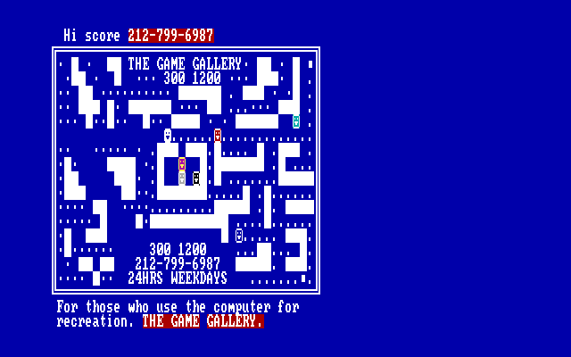
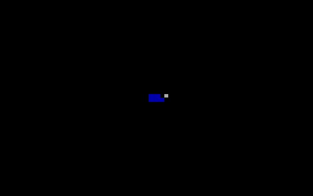

# ANSImate

[](https://pkg.go.dev/github.com/bengarrett/ansimate)

ANSImate converts continuous ANSI streams (ANSimations) found in the PC BBS and MS-DOS era into lightweight, lossless animated WebP images in pure Go.

#### Features

- Pure Go with no external binary dependencies.
- DOS VGA rendering using an authentic IBM VGA, 8×16 BIOS ROM font bitmap.
- Emulates BBS streaming transmission rates and frame ticks.
- Lossless animated WebP output.
- Heuristic and SAUCE detection to distinguish dynamic animations from static ANSI artworks.
- ANSI.SYS terminal support including cursor positioning, movements (`CSI A-D`), screen/line clearing, and SGR colors.

#### ANSImation?

ANSI escape codes are a terminal standard that goes back to minicomputers of the late 1970s. On 16-bit microcomputers, it became popular on online bulletin boards later in the 1980s. This allowed boards to offer color, cursor movement, and overall more striking user interfaces, though it came at the expense of complexity. The creators of these interfaces evolved into artists drawing adverts for these bulletin boards, and popular drawing tools of the era like [The Draw](https://winworldpc.com/product/the-draw/3x) allowed for the creation of streaming ANSI art files, to display the artwork onscreen as they were downloaded over slow, copper telephone lines.

We first started seeing ANSI artists using the blink character options to add visual movement to their otherwise static art. And I would guess this evolved into exploring the ability to control the text cursor movement to generate animations. These animations initially started as TV and movie-style screen wipes and later expanded in complexity into moving adverts and animated comic strips, and these became known as ANSImations.

[](https://defacto2.net/f/ba2bcbb)

_1985 advert for The Game Gallery BBS_

[](https://defacto2.net/f/b21a2ed)

_1988 advert for the Pass It On BBS_

[](https://defacto2.net/f/ac2c5c0)

_1991 advert for the BBS-a-Holic BBS by RaD Man_

[](https://defacto2.net/f/b02d6c9)

_1993 'A Tribute Ansimation' By Kronos_

<small>
  The example images were created using ANSImate, however, the &copy; belongs to their authors.
  These authors do not endorse ANSImate and permission for their use in this article was never asked.
</small>

#### Quick Usage

Convert an ANSImation ANSI file to an web-friendly, animated WebP image.

```go
package main

import (
	"log"
	"os"

	"github.com/bengarrett/ansimate"
)

func main() {
	input, err := os.Open("animation.ans")
	if err != nil {
		log.Fatal(err)
	}
	defer input.Close()

	output, err := os.Create("animation.webp")
	if err != nil {
		log.Fatal(err)
	}
	defer output.Close()

	if err := ansimate.Animate(output, input, nil); err != nil {
		log.Fatal(err)
	}
}
```

#### Detect if a file is an ANSImation

```go
ok, err := ansimate.Detect(file)
if err != nil {
	log.Fatal(err)
}
if ok {
	fmt.Println("File is an ANSImation!")
}
```

#### Custom Configuration

```go
cfg := &ansimate.Config{
	BaudRate:    14400,                  // 14.4k baud modem speed
	FPS:         20,                     // 20 frames per second
	MaxDuration: 10 * time.Second,       // Cap animation at 10s
	EndDelay:    3 * time.Second,        // Hold final completed frame for 3s
	Lossy:       true,                   // Use lossy image compression, but it is not recommended
	Palette:     ansimate.PaletteMono,   // Or PaletteAmber, PaletteGreen, PaletteVGA
}

err := ansimate.Animate(output, input, cfg)
```

#### Command-line Tool

A standalone program is provided for converting files without writing Go code.

[Download the latest](https://github.com/bengarrett/ansimate/releases/latest), or:

```bash
# Build the binary
cd ansimate
go build .

# Convert an ANSImation to WebP
./ansimate animation.ans

# Check whether a file is an ANSImation
./ansimate -check animation.ans

# Convert with custom baud rate, end pause delay, and monochrome palette
./ansimate -baud 28800 -fps 20 -delay 3.0s -palette mono animation.ans output.webp
```

### Examples

Check out [`testdata/`](testdata/) for a number of WebP animations created by ansimate.

### License

This project is licensed under the [MIT License](LICENSE).

Test artwork files located in `testdata/` remain the copyright of their respective authors and are included strictly for automated regression testing and format conformance. See [testdata/README.md](testdata/README.md) for full attributions.
